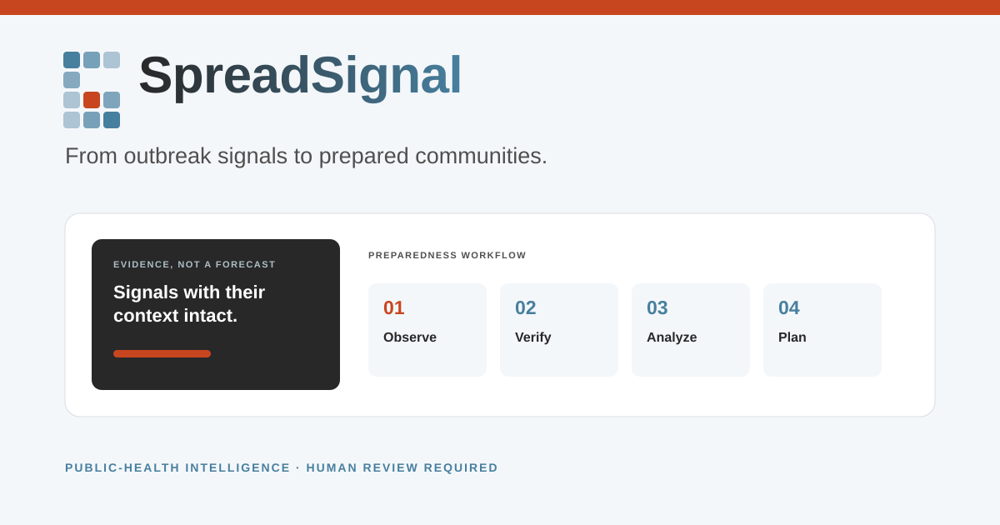

<p align="center">
  
</p>

# SpreadSignal

> **Outbreak intelligence, made clear.**

SpreadSignal helps communities make sense of outbreak signals by bringing trends, evidence, and preparedness planning into one clear workspace.

It is designed for the moments when teams need to move from “something may be changing” to a proportionate, human-reviewed next step—without treating a data point as a forecast or medical advice.

## See the signal. Keep the context.

SpreadSignal organizes outbreak intelligence as a practical workflow:

1. **Observe** — see recent, pathogen-specific activity with its measurement context.
2. **Explore** — compare compatible state-level observations side by side.
3. **Verify** — inspect source, coverage, retrieval date, method, and caveats.
4. **Analyze** — investigate patterns as exploratory evidence, never as a prediction.
5. **Plan** — turn the evidence into proportionate preparedness actions that remain under human review.

## Built for responsible public-health decisions

- **Evidence first** — every view keeps provenance and limitations close to the data.
- **Pathogen-aware** — the release lists only pathogens with an available, comparable public source.
- **Human-directed** — planning support never replaces human judgment or approval.
- **Transparent by design** — comparisons preserve the context needed to interpret them responsibly.

## Live public release scope

SpreadSignal currently presents live, weekly CDC National Wastewater Surveillance System data for **COVID-19, Influenza A, and RSV** at U.S. national and state level. It intentionally does not list pathogens without an available, comparable public source in this release.

The dashboard and state comparison use the CDC wastewater viral activity dataset directly in the browser. Values may be revised by the source; reporting-site counts describe contributing sites, not population coverage. When the source cannot be reached or does not provide enough comparable data, SpreadSignal shows an unavailable state rather than substitute figures.

Read [DATA_SOURCES.md](DATA_SOURCES.md) before relying on the data. SpreadSignal is not medical advice, a diagnosis, or a forecast.

## Run locally

SpreadSignal is a dependency-free static application.

```bash
python3 -m http.server 8000
```

Then open [http://localhost:8000](http://localhost:8000).

## Built with

HTML, CSS, vanilla JavaScript, SVG, and the public CDC Socrata API.

---

*A clearer path from outbreak signals to prepared communities.*
